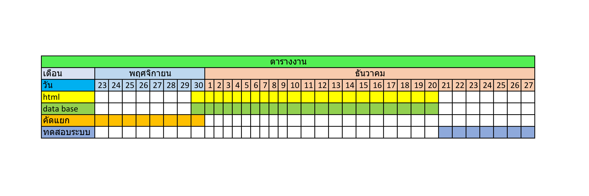

# database_project

Project data base

### ตารางเวลาทำโปรเจค

## ชื่อเวลาเซฟ commit
ทุกครั้งที่ คอมมิค ให้มี สกุลไฟล์นำหน้าด้วยเช่น `<py>`,`<html>` เป็นต้น

| ชื่่อ   | หน้าที่ | งานที่ต้องทำ |
|:-------:|:----------:|:-----------:|
|เมศ    |||
|ปั้น     |||
|แก้ว    |||
|วิทย์    |||
|ขิง     |||
|บาว    |||
|ผ้าย    |||

## งานที่ต้องทำ

### Global
- [ ] เขียน log book กันทุกคน

### HTML

#### HTML[A]
- [ ] สร้าง index.html
- [ ] แถบค้นหา และระบบ tag (รุ่นปี,อาจารย์,ประเภท)
- [ ] หน้าแสดงการค้นหา
- [ ] หน้ารายละเอียดโครงงาน
- [ ] หน้าล็อคอิน และ เปลี่ยนรหัสผ่าน
- [ ] หน้าของ staff (สร้างบัญชีนักศึกษา, จัดการ tag ประเภท)

#### HTML[B]
- [ ] ตั้งค่าโปรเจกต์ Flask
- [ ] เชื่อม Flask กับ MySQL
- [ ] ส่งข้อมูลไปแสดงในหน้าเว็บ (ค้นหา, กรองด้วย tag)
- [ ] รับข้อมูลจากฟอร์มบันทึกลงฐานข้อมูล
- [ ] ระบบล็อกอินและสิทธิ์ student / staff

### Database

#### Database[A]
- [ ] ติดตั้ง MySQL บนเซิร์ฟเวอร์
- [ ] สร้างบัญชีผู้ใช้ MySQL สำหรับ Flask
- [ ] ทำตาม ER
- [ ] ตั้งระบบสำรองข้อมูลอัตโนมัติ

#### Database[B]
- [ ] เตรียมข้อมูลพื้นฐาน: รุ่นปี, รายชื่ออาจารย์, ประเภทโครงงาน
- [ ] นำเข้าข้อมูลโครงงานรุ่นพี่ที่ได้จากกลุ่ม PDF ลงฐานข้อมูล
- [ ] ตรวจความถูกต้องของข้อมูล (ชื่ออาจารย์สะกดตรงกัน, ไม่มีข้อมูลซ้ำ)
- [ ] เตรียมวิธีนำเข้ารายชื่อนักศึกษาจากไฟล์ Excel (ใช้ตอน staff สร้างบัญชี)
- [ ] เขียนคำสั่ง SQL สำหรับ ค้นหา, กรองด้วย tag, ดูรายละเอียด, โครงงานที่อ้างอิง ส่งให้ HTML[B]

### PDF
- [ ] รวมไฟล์
- [ ] แยกปี
- [ ] แยกข้อความ ด้วยโปรแกรมแยกข้อความออกจากภาพ
- [ ] ทำหน้าHTML อัพโปรเจต

### TEST
- [ ] ทดสอบระบบเชื่อมฐานข้อมูล
- [ ] ทดสอบ ROLE
- [ ] ทดสอบ การเพิ่ม tag ใหม่
- [ ] ทดสอบการใช้งานพร้อมกันหลายคน

### จัดทำโดย
|ชื่อ-นามสกุล|รหัสนักศึกษา|
|---|---|
|นางสาวพรพิรุณ ขามเทศ | 6710301020 |  
|นายสิรวิทย์ วิริยะอาทร | 6710301021 | 
|นายพรราเมศวร์ กวีวรรณ | 6710301031 | 
|นายชนน วิไลขำ | 6710301042 |
|นายทัศนัย พินิจประเสริฐ | 6710301045 |  
|นายศุทธมนต์ รอดรัศมี | 6710301049 |
|นายชลนภัส รักษ์เจริญ | 6710301051 |